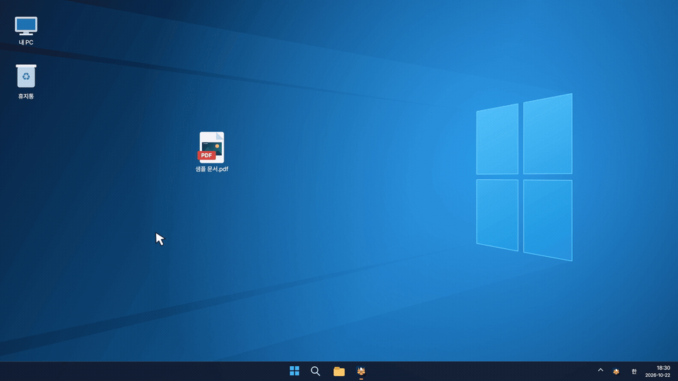

# Citrus Drop

**파일을 끌고 Shift를 누르면, 원하는 형식으로 변환됩니다.**

> **v0.3.3 · Pre-release** — 기능을 추가하고 다듬는 개발 중 버전입니다.

**[Windows EXE 다운로드](https://github.com/clou-dd/citrus-drop/releases/download/v0.3.3/CitrusDrop.exe)** · [릴리스 안내](https://github.com/clou-dd/citrus-drop/releases/tag/v0.3.3)

Windows 10/11 64비트에서 다운로드한 `CitrusDrop.exe`를 실행하세요.

## 사용 방법

1. 파일을 마우스로 끌기 시작합니다.
2. 끄는 도중 **Shift를 한 번** 누릅니다.
3. 원형 메뉴에서 원하는 형식 위에 놓습니다.

원본은 유지하고 같은 폴더에 결과를 저장합니다. 기본 창에서 파일을 추가해 변환할 수도 있습니다.

### 드래그·Shift 원형 메뉴

## 지원 기능

| 파일 | 할 수 있는 작업 |
| --- | --- |
| 이미지 | PNG·JPG·BMP·TIFF·GIF·WebP 변환, PDF 만들기 |
| PDF | 페이지를 PNG·JPG로 저장, 문자만 TXT로 추출 |
| 영상·음성 | MP4·WebM, MP3·WAV·FLAC·OGG 등으로 변환 |
| 일반 파일 | ZIP 압축, 전체 경로 복사 |

- 영상·음성 변환은 `FFmpeg 선택`으로 **FFmpeg를 별도 연결**해야 합니다.
- PDF 문자 추출은 OCR을 지원하지 않습니다. GIF·TIFF는 첫 프레임을 사용합니다.
- 트레이를 사용할 수 있으면 `창 닫기` 후에도 계속 실행합니다. 완전히 끝내려면 `프로그램 종료`를 누르세요.

파일은 서버에 업로드하지 않고 PC에서 처리합니다.

## 앞으로 추가할 기능

이미지 자르기·크기 변경·회전, 품질·저장 위치 설정, PDF 합치기·분할을 계획하고 있습니다.

[상세 사용 안내](docs/USAGE.md) · [변경 내역](docs/CHANGELOG.md) · [개발자 안내](docs/DEVELOPMENT.md) · [문제 제보](https://github.com/clou-dd/citrus-drop/issues)

[MIT 라이선스](LICENSE) · 제작·유지관리: [clou-dd](https://github.com/clou-dd) · 개발에 OpenAI Codex 활용 · [제작 정보](AUTHORS.md) / [외부 구성요소](THIRD_PARTY_NOTICES.md)
