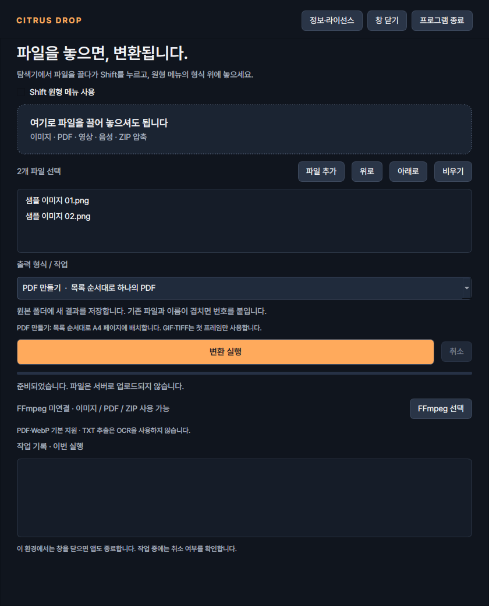
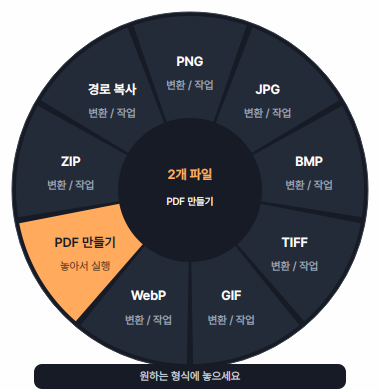
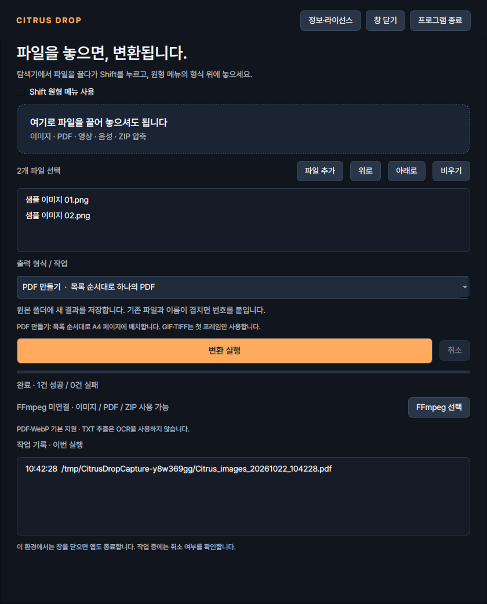

# Citrus Drop

<p align="center"></p>

<p align="center"><strong>끌어 놓는 순간, 파일 변환이 간편해집니다.</strong></p>

> 🚧 지속적으로 기능을 추가하고 개선하는 개발 중 프로젝트입니다.

윈도우용 로컬 파일 변환 앱입니다. 파일을 끌다가 **Shift**를 누르면 원형 메뉴가 나타나고, 원하는 형식 위에 놓으면 변환합니다. 기본 창에서 파일을 선택해 실행할 수도 있습니다.

현재 버전은 **Python + PySide6** 기반이며 이미지·PDF·영상·음성 변환과 ZIP 압축을 지원합니다.

## 버전 안내

**현재 버전: v0.3.3** · **업데이트: 2026-10-22**

| 버전 | 주요 변경 |
| --- | --- |
| **v0.3.3 · 현재** | 상단 버튼을 읽기 쉬운 `앱 정보`로 정리, 버전·제작 정보·라이선스 확인 기능 유지 |
| **v0.3.2** | EXE 하나로 배포하도록 변경, 정보·라이선스 창 추가, 실제 앱 화면과 버전 안내 정리 |
| **v0.3.1** | 항상 보이는 창 닫기·프로그램 종료 버튼, 트레이 동작 안내, 개발 예정 기능 정리 |
| **v0.3.0** | Python·PySide6 전환, 로고·Windows EXE 배포, 콘솔 실행 개선, Pretendard 적용, MIT·제작 정보 정리 |
| **v0.2 · 초기 버전** | C#·WPF 기반 Windows 앱, Shift 원형 메뉴·트레이, 이미지·PDF·영상·음성 변환과 ZIP 압축 |

## 실제 앱 화면

v0.3.2 앱을 직접 실행한 화면입니다. **Linux의 Qt offscreen 환경**에서 캡처했으며, 원형 메뉴에는 샘플 파일을 담은 Qt 드롭 이벤트를 전달했습니다. Windows 탐색기에서 마우스로 드래그한 장면은 아닙니다.

**기본 창 · 이미지 두 개를 PDF로 변환할 준비**



**원형 메뉴 · PDF 만들기 강조**



<details>
<summary>실제 PDF 변환 완료 화면</summary>

이미지 두 개를 실제로 변환했고, 생성된 PDF의 2페이지 구성과 첫 페이지 렌더링을 확인했습니다.



</details>

## 진행 예정

아래는 **아직 구현되지 않은 기능의 개발 방향**입니다. 이미지 기본 편집부터 진행하며, 범위와 순서는 사용성 검토·테스트 결과에 따라 조정합니다.

| 우선순위 | 예정 기능 | 내용 | 상태 |
| --- | --- | --- | --- |
| 1 | 이미지 기본 편집 | 미리보기, 영역 자르기, 크기 변경, 회전·뒤집기 | 계획 |
| 2 | 변환 설정 | 이미지 품질·해상도 조절, 용량 줄이기, 결과 저장 폴더 선택 | 계획 |
| 3 | PDF 기능 확장 | PDF 합치기·분할, 페이지 선택·추출, 페이지 순서 변경 | 검토 |
| 4 | 사용 환경·배포 개선 | Windows 시작 시 실행, 단축키 설정, 다중 모니터·DPI 검사, SignPath 무료 서명 신청 검토 | 검토 |

## 제작 및 개발 방식

- 프로젝트 기획·유지관리: [clou-dd](https://github.com/clou-dd)
- 공식 저장소: [clou-dd/citrus-drop](https://github.com/clou-dd/citrus-drop)
- 개발 과정의 코드 생성·수정·검증에 **OpenAI Codex**를 활용합니다.

제작 정보는 [AUTHORS.md](AUTHORS.md)에 정리합니다. 단일 EXE에도 포함하며 앱 상단의 `앱 정보`에서 확인할 수 있습니다.

## 빠른 실행

### EXE로 실행

1. [Windows EXE 빌드](https://github.com/clou-dd/citrus-drop/actions/workflows/windows-build.yml)에서 최신 성공한 실행을 여세요.
2. 아래쪽 **Artifacts → CitrusDrop-windows-x64**를 내려받으세요. GitHub 로그인이 필요할 수 있습니다.
3. ZIP을 압축 해제하고 **`CitrusDrop.exe` 하나를 실행**하세요. Python 설치나 CMD 창 없이 실행됩니다.

**v0.3.2부터 `_internal` 폴더 없이 배포합니다.** Qt·PDF 엔진·로고·폰트가 EXE에 포함됩니다. 실행할 때 필요한 내부 파일을 임시 폴더에 풀기 때문에 시작에 잠시 시간이 걸릴 수 있으며, 정상 종료 시 임시 폴더를 정리합니다. 영상·음성용 FFmpeg는 별도로 연결합니다. 이전 버전 ZIP에는 `_internal` 폴더가 있으므로 최신 성공한 빌드를 받아 주세요.

### Python 소스로 실행

Windows 10/11 **64비트**, Python **3.11~3.13**이 필요합니다. 검증에 사용한 Python은 3.12입니다.

1. 저장소를 내려받아 압축을 모두 해제하세요.
2. 처음에는 `Setup.cmd`를 실행하세요. `.venv` 가상환경을 만들고 패키지와 Pretendard 폰트를 준비합니다. 최초 설치에는 인터넷이 필요합니다.
3. `Start.cmd`를 실행하세요. 또는 `.venv\Scripts\python.exe main.py`로 실행할 수 있습니다.
4. 소스를 업데이트한 뒤에는 `Setup.cmd`를 다시 실행하여 의존성을 맞춰 주세요.

`Start.cmd`는 `pythonw.exe`를 별도 프로세스로 실행하고 돌아옵니다. 더블클릭할 때 CMD 창이 잠깐 나타날 수 있지만 앱이 종료될 때까지 남아 있지는 않습니다. 최초 설치·설치 오류를 표시하는 동안에는 콘솔 창이 유지됩니다. 시작 오류는 `%LOCALAPPDATA%\CitrusDrop\startup-error.log`에서 확인할 수 있습니다. 콘솔에서 직접 오류를 확인하려면 `.venv\Scripts\python.exe main.py`로 실행하세요.

이미 Python 3.14 이상이 기본으로 지정돼 있다면 `py -3.12 -m venv .venv`처럼 지원 버전으로 가상환경을 먼저 만든 뒤 Setup.cmd를 실행하세요.

직접 설치하는 경우:

```powershell
py -3.12 -m venv .venv
.venv\Scripts\python.exe -m pip install -r requirements.txt
.venv\Scripts\python.exe tools\fetch_fonts.py
.venv\Scripts\python.exe main.py
```

관리자 권한은 필요하지 않습니다. 탐색기와 앱을 같은 일반 권한으로 실행해 주세요. 앱 소스 폴더와 변환 결과를 저장할 원본 폴더에 쓰기 권한이 필요합니다.

## 사용 방법

- 탐색기에서 파일을 선택하고, 마우스 버튼을 계속 누른 채 끌기 시작합니다.
- 파일을 조금 움직인 뒤 **Shift를 한 번 누릅니다**. Shift를 먼저 누른 채 끌기 시작하는 순서는 지원하지 않습니다.
- 원형 메뉴 안으로 파일을 이동하면 가능한 형식이 표시됩니다. 주황색으로 강조된 항목 위에 놓으면 실행됩니다.
- Shift를 떼어도 메뉴는 유지됩니다. 중앙·항목 사이의 틈은 실행 영역이 아닙니다.
- Esc를 누르거나 메뉴 밖에서 드래그를 끝내면 메뉴가 닫힙니다.
- 기본 창에서도 파일 추가·드롭 → 출력 형식 선택 → 변환 실행이 가능합니다.
- 이미지 PDF의 페이지 순서는 파일 목록의 `위로`·`아래로`로 변경할 수 있습니다.
- 상단의 `창 닫기`나 제목 표시줄의 X를 누르면 트레이에 남습니다. 트레이 아이콘을 더블클릭하면 다시 열립니다. 완전 종료는 상단의 `프로그램 종료` 또는 트레이 메뉴의 `종료`입니다. 트레이를 제공하지 않는 환경에서는 창을 닫을 때 종료하며, 작업 중이면 취소 여부를 확인합니다.

## 지원 기능

| 구분 | 입력 | 출력 / 동작 | 준비 |
| --- | --- | --- | --- |
| 이미지 | PNG, JPG/JPEG, BMP, TIFF/TIF, GIF, WebP | PNG, JPG, BMP, TIFF, 정지 GIF, WebP | Python 패키지 설치 |
| 이미지 PDF | 위 이미지 하나 또는 여러 개 | 목록 순서대로 하나의 PDF | Python 패키지 설치 |
| PDF 이미지화 | PDF | 모든 페이지를 PNG/JPG로 저장 | Python 패키지 설치 |
| PDF 문자 추출 | 문자가 들어 있는 PDF | UTF-8 TXT | Python 패키지 설치 |
| 영상 | MP4, MOV, MKV, WebM, AVI, WMV, M4V | MP4, WebM, MP3, WAV, FLAC, OGG | FFmpeg 선택 |
| 음성 | MP3, M4A, WAV, FLAC, OGG, Opus, AIFF/AIF, WMA | MP3, WAV, FLAC, OGG | FFmpeg 선택 |
| 압축 | 선택한 일반 파일 | 하나의 ZIP | 추가 준비 없음 |
| 경로 복사 | 선택한 일반 파일 | 전체 경로를 줄바꿈으로 클립보드에 복사 | 추가 준비 없음 |

**PDF와 WebP에는 Poppler나 별도 실행 파일을 연결할 필요가 없습니다.** PDFium·Pillow 등이 Python 패키지에 포함됩니다. 영상·음성만 FFmpeg를 사용합니다. 사용한 Pillow 빌드가 WebP를 지원하지 않으면 해당 메뉴가 숨겨집니다.

서로 다른 종류의 파일을 함께 선택하면 ZIP·경로 복사만 표시됩니다. 폴더는 파일 목록에서 제외됩니다. 가상 파일·메일 첨부 객체는 먼저 일반 파일로 저장해 주세요.

### 이미지와 PDF 처리 기준

- 원본 파일은 유지하고, 결과는 원본과 같은 폴더에 새로 만듭니다.
- 기본 결과 이름은 `원래이름_converted.확장자`입니다. 같은 이름이 있으면 `_2`, `_3`을 붙입니다.
- JPG·WebP 품질은 90입니다. JPG·BMP와 이미지 PDF의 투명 영역은 흰색입니다.
- 이미지 EXIF 방향을 픽셀에 반영하며 원본 이미지 메타데이터는 복사하지 않습니다. 인쇄용 색상 프로파일 보존은 보장하지 않습니다.
- GIF 애니메이션·다중 페이지 TIFF는 파일마다 **첫 프레임 하나**를 사용합니다.
- 이미지 PDF는 A4 세로/가로를 이미지 방향에 맞춰 선택하고, 비율을 유지해 중앙 배치합니다. 여백은 최소 24pt이며 잘라내지 않습니다. ReportLab에 픽셀 이미지를 전달해 PDF에 삽입합니다.
- 이미지 PDF는 첫 입력 이미지의 폴더에 저장합니다. 여러 입력이면 `Citrus_images_날짜_시간.pdf`입니다.
- PDF → PNG/JPG는 **150 DPI**, JPG 품질 90으로 모든 페이지를 출력합니다. `원래이름_png_pages` 또는 `원래이름_jpg_pages` 폴더에 페이지 번호 순으로 저장합니다. 기존 폴더가 있으면 번호를 붙입니다.
- TXT는 PDF 안의 문자만 추출합니다. **OCR은 하지 않습니다.** 이미지 전용 PDF는 빈 TXT가 나올 수 있으며, 문단·표 순서는 원본과 다를 수 있습니다.
- 열기 암호 입력 기능은 없습니다. 암호가 필요한 PDF·손상된 PDF는 오류로 표시합니다.
- PDF 렌더링은 스레드 간 잠금으로 직렬화합니다. PDFium을 동시에 호출하지 않습니다.
- 1억 픽셀을 넘는 입력 이미지나 PDF 렌더링 페이지는 거부합니다. 디코딩 단계의 전체 메모리 사용량에 대한 별도 제한은 없습니다.

### 취소와 오류

작업 중 취소할 수 있습니다. FFmpeg 프로세스는 중지하고, PDF·이미지는 현재 디코딩/인코딩 호출이 끝난 뒤 취소될 수 있습니다. 취소·실패한 현재 파일의 임시 출력은 정리를 시도합니다. 취소 전에 완료된 결과는 유지됩니다. 이미지 PDF와 ZIP은 전체 선택을 하나의 작업으로 처리합니다.

PDF 페이지는 임시 폴더에서 모두 변환한 뒤 새 결과 폴더로 옮깁니다. 기존 결과 파일과 폴더를 덮어쓰지 않습니다. 강제 종료·권한 오류가 있으면 `.citrus-drop-…` 임시 폴더가 남을 수 있습니다.

일괄 변환 중 파일 하나가 실패해도 다음 파일은 계속 처리하고 기록을 남깁니다. 여러 작업을 동시에 실행하지는 않습니다. 작업 기록과 선택 파일 목록은 이번 실행 동안만 유지합니다.

## FFmpeg 연결

1. [FFmpeg 공식 다운로드 안내](https://ffmpeg.org/download.html)에서 신뢰할 수 있는 Windows 배포본을 준비하세요.
2. 앱의 `FFmpeg 선택`으로 `ffmpeg.exe`를 지정하세요.
3. 또는 EXE/소스 폴더 옆의 `tools/ffmpeg.exe`에 배치하세요. 필요한 DLL이 있으면 배포본의 구조를 유지하세요.

FFmpeg는 포함하거나 자동 다운로드하지 않습니다. 실제 코덱 지원은 선택한 빌드에 따라 달라집니다. H.264/AAC, VP9/Opus, MP3/Vorbis 등 출력 인코더가 필요합니다. 외부 프로세스는 인수 목록으로 실행하며 셸을 사용하지 않습니다.

설정은 `%LOCALAPPDATA%\CitrusDrop\settings.json`에 저장합니다. 기존 C# 버전의 `ffmpeg-path.txt`가 있으면 경로를 이어서 사용합니다. 이전 Poppler 설정은 더 이상 필요하지 않습니다.

## EXE로 빌드

**Windows에서** `build.cmd`를 실행하세요. 패키지를 설치하고 PyInstaller로 `dist/CitrusDrop.exe`를 만듭니다.

GitHub의 `Windows EXE` 워크플로도 Windows x64 환경에서 테스트·아이콘 생성·빌드·EXE 실행 검사를 수행하고 단일 EXE를 Artifacts로 제공합니다. EXE만 새 폴더에 복사한 뒤 내장 폰트·이미지 → PDF → PNG 변환·종료까지 검사합니다. 소스 변경 시 자동 실행되며 Actions에서 `Run workflow`로 다시 빌드할 수도 있습니다.

- 사용자 PC에 Python을 별도 설치하지 않고 배포할 수 있도록 만드는 구성입니다.
- **`CitrusDrop.exe` 하나만 전달하면 됩니다.** Qt·PDFium·라이브러리 데이터·폰트는 EXE 내부에 포함합니다.
- FFmpeg는 별도로 선택하거나 EXE 옆 `tools` 폴더에 배치합니다.
- Windows용 EXE는 Windows에서 빌드해야 합니다. Linux 빌드 결과를 Windows용으로 사용할 수 없습니다.
- 라이브러리 공지·프로젝트 제작 정보·폰트 라이선스는 EXE에 포함하며 `앱 정보`에서 읽을 수 있습니다. 재빌드할 때도 고지를 유지하세요. 자세한 내용은 THIRD_PARTY_NOTICES.md에 있습니다.

## 로고

프로젝트 로고 `assets/citrus-drop.svg`를 앱 창·트레이·EXE 아이콘에 연결했습니다. `tools/generate_icons.py`가 `assets/logo.png`와 여러 크기가 들어 있는 `assets/icon.ico`를 생성합니다. `build.cmd`와 GitHub 빌드에서 자동 실행합니다. 자세한 내용은 `assets/README.md`를 참고하세요.

## 폰트

기본 창·원형 메뉴·트레이 메뉴는 **Pretendard**를 사용합니다. 본문 14px, 보조 설명 12px, 주요 제목 28px를 기준으로 Regular·SemiBold·Bold 굵기를 구분했습니다. 앱에 폰트가 포함되어 사용자 PC에 별도로 설치할 필요가 없습니다.

Pretendard v1.3.9 원본은 **SIL Open Font License 1.1**로 배포되며 앱에 포함한 배포와 상업적 사용이 허용됩니다. 폰트는 수정하지 않았으며, 원본 저작권 고지와 라이선스는 `assets/fonts/OFL.txt`에 포함합니다. 폰트의 OFL은 앱 소스의 라이선스와 별도로 유지됩니다.

소스 설치·빌드 시 공식 저장소의 고정된 버전에서 원본 OTF 3개를 받아 SHA-256을 확인합니다. 앱 실행 중에는 폰트를 다운로드하거나 시스템에 설치하지 않습니다. 자세한 출처는 `assets/fonts/README.md`를 참고하세요.

## 소스 구조

| 파일 | 수정할 내용 |
| --- | --- |
| `main.py` | 실행 진입점 |
| `citrus_drop/ui.py` | 한국어 기본 창, 원형 메뉴, 드롭 |
| `citrus_drop/app.py` | 트레이, 작업 스레드, 시작·종료 |
| `citrus_drop/native.py` | 윈도우 입력 상태, Shift 제스처 |
| `citrus_drop/models.py` | 지원 형식과 메뉴 규칙 |
| `citrus_drop/converters.py` | 이미지·FFmpeg·ZIP |
| `citrus_drop/pdf_tools.py` | 이미지 PDF, PDF 페이지 이미지·문자 추출 |
| `citrus_drop/jobs.py` | 일괄 처리·취소·작업 기록 |
| `citrus_drop/storage.py` | 결과 이름 충돌 방지·설정·임시 파일 |
| `citrus_drop/typography.py` | 앱 내 Pretendard 로딩·기본 글꼴 |
| `tools/fetch_fonts.py` | 설치·빌드 시 공식 원본 폰트 준비·해시 확인 |
| `CitrusDrop.spec` | EXE 패키징 구성 |

## 테스트

```powershell
.venv\Scripts\python.exe -m pip install -r requirements-dev.txt
.venv\Scripts\python.exe -m pytest -q
```

또는 `tests/run-tests.cmd`를 실행하세요. 자동 환경에서는 `--no-pause`를 추가합니다. Qt 테스트는 offscreen 환경에서 화면·메뉴·드롭 이벤트와 작업 스레드를 검사합니다. `python main.py --smoke-test`로 실제 앱 초기화·종료도 확인할 수 있습니다.

현재 검증 결과와 남은 Windows 실기기 항목은 VALIDATION.md에 기록합니다.

## 알려진 제한

- 전역 Shift 메뉴는 Windows 전용입니다. 다른 OS에서는 기본 창의 파일 선택·드롭으로 변환을 테스트할 수 있습니다.
- 드래그는 마우스 버튼·이동·Shift 상태로 감지합니다. 파일이 아닌 드래그에서도 메뉴가 잠시 뜰 수 있지만, 실제 로컬 파일 드롭이 있어야 변환합니다. 키 입력 내용이나 클립보드 내용을 수집하지 않습니다.
- Windows 탐색기와 실제 OLE 드롭, 혼합 DPI·다중 모니터·RDP는 실기기 확인이 필요합니다.
- HEIC/AVIF/SVG, Word/엑셀/프레젠테이션 변환, PDF → Word, OCR, 크롭·PDF 편집·자동 실행·단축키 변경은 구현하지 않았습니다.
- 변환 중 파일을 서버로 업로드하지 않습니다. 초기 패키지 설치와 선택적 빌드 도구 설치만 인터넷을 사용합니다.

## 라이선스 및 사용 안내

Citrus Drop은 **MIT 라이선스**로 공개하는 오픈소스 프로젝트입니다.

- 개인·회사·상업적 환경에서 사용, 복제, 수정, 재배포 및 판매할 수 있습니다.
- 소프트웨어의 사본이나 상당 부분을 재배포할 때는 **원래 저작권 고지와 MIT 라이선스 허가 문구를 유지**해야 합니다.
- 사용한 라이브러리·폰트에는 각각의 라이선스가 적용됩니다. [THIRD_PARTY_NOTICES.md](THIRD_PARTY_NOTICES.md)를 함께 확인하세요.
- 자세한 조건은 [LICENSE](LICENSE), 제작 정보는 [AUTHORS.md](AUTHORS.md)를 확인하세요.

## 참고

- [Qt for Python](https://doc.qt.io/qtforpython-6/)
- [Pillow](https://pillow.readthedocs.io/)
- [pypdfium2](https://pypdfium2.readthedocs.io/en/stable/python_api.html)
- [ReportLab](https://docs.reportlab.com/)
- [PyInstaller](https://pyinstaller.org/)
